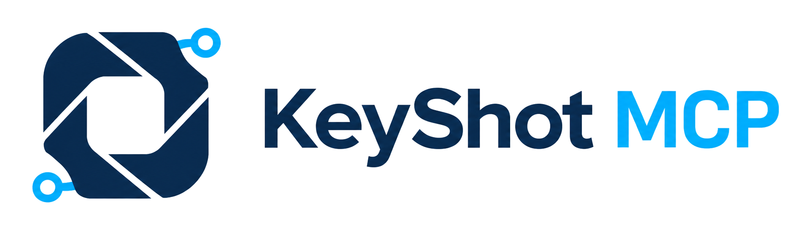
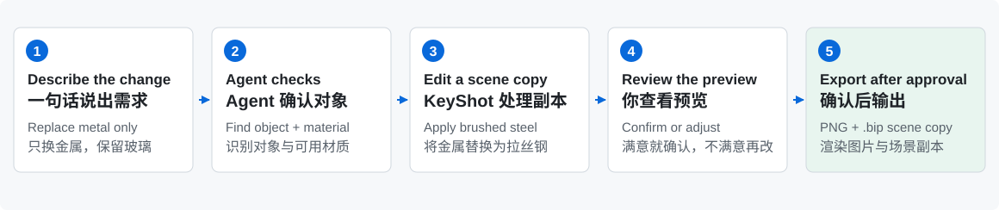
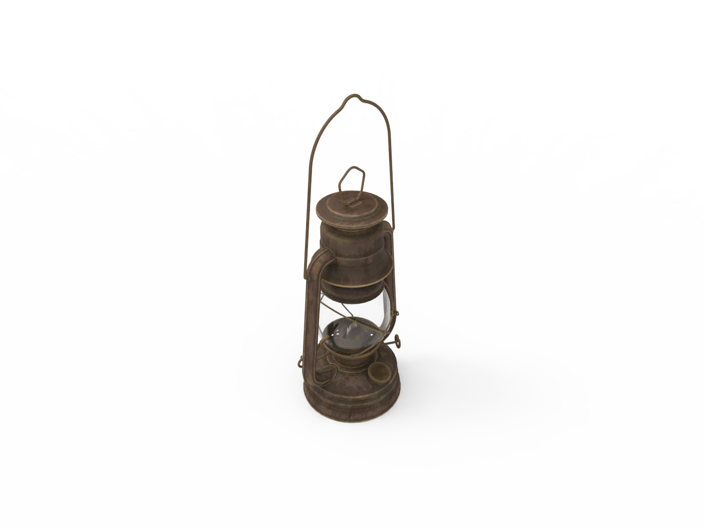
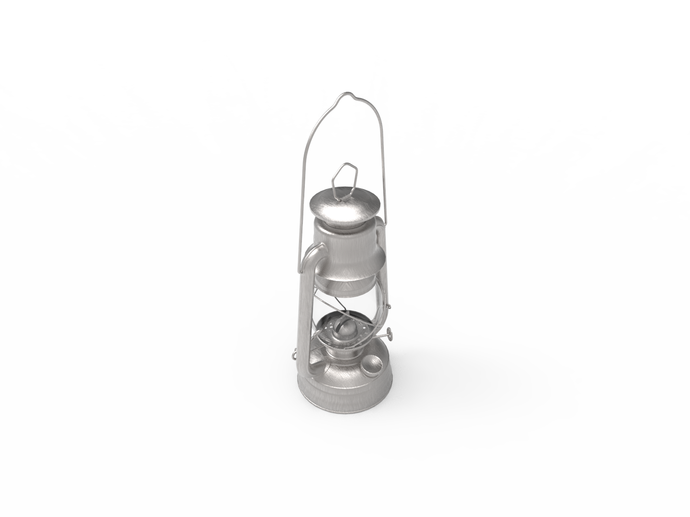

<p align="center">
  
</p>

<p align="center">
  <strong>Product rendering in KeyShot, guided by your AI agent.</strong><br>
  <strong>让 AI Agent 协助完成 KeyShot 产品渲染。</strong>
</p>

<p align="center">
  Inspect a saved scene, adjust selected materials and cameras, review a preview, and render a scene copy.<br>
  检查已保存的场景，调整指定对象的材质和相机，先看预览，再从副本出图。
</p>

<p align="center">
  <a href="https://www.npmjs.com/package/keyshot-mcp"></a>
  <a href="https://api.npmjs.org/downloads/point/2026-07-09:2026-10-20/keyshot-mcp" title="Cumulative npm downloads as of 2026-10-20 / npm 累计下载量，截至 2026-10-20"></a>
  <a href="https://github.com/truman-t3/keyshot-mcp/actions/workflows/ci.yml"></a>
  <a href="LICENSE"></a>
  <a href="https://m8ven.ai/mcp/truman-t3-keyshot-mcp-v7af97" title="M8ven external verification (live status) / M8ven 第三方验证（动态状态）"></a>
</p>

<p align="center">
  
  
  
  
  
</p>

<p align="center">
  <a href="#english">English</a> · <a href="#中文">简体中文</a><br>
  <a href="#from-a-request-to-a-render--一句话到出图">How it works / 使用流程</a> ·
  <a href="#product-demo--产品实测">Demo / 实测</a> ·
  <a href="#quick-start">Quick start</a> ·
  <a href="#workflows">Workflows</a> ·
  <a href="#tool-reference">Tools</a> ·
  <a href="#快速开始">中文安装</a>
</p>

<p align="center">
  <strong>Useful for your KeyShot workflow? Star the repository to help other designers discover it.</strong><br>
  <strong>如果它改善了你的 KeyShot 工作流，欢迎点一个 Star，让更多设计师发现这个项目。</strong>
</p>

> [!IMPORTANT]
> **Saved scenes, not realtime GUI control.** KeyShot MCP runs headless on the same
> computer as KeyShot. It does not read unsaved edits or control the open KeyShot window.
> **处理已保存的场景，不是实时 GUI 控制。** 服务在本机后台运行 KeyShot，不能读取窗口中尚未保存的修改。
>
> **Client Agent and privacy.** The Agent in your MCP client receives scene information
> and previews returned by tools. Depending on the client's implementation and settings,
> these results may be sent to its configured model provider. KeyShot MCP itself does
> not upload them. Review [privacy and security](SECURITY.md) before confidential work.
>
> **客户端 Agent 与隐私。** MCP 客户端中的 Agent 会接收工具返回的场景信息和预览；
> 这些内容可能根据客户端的实现与配置发送给其所选模型服务。KeyShot MCP 本身不主动上传这些内容。
> 保密项目请先阅读[隐私与安全说明](SECURITY.md)。

## From a Request to a Render / 一句话到出图

After setup, describe the change to your Agent. It uses KeyShot MCP to perform
the work on a saved scene copy; you review the preview before final output.
完成安装后，直接向 Agent 描述需求。它通过 KeyShot MCP 处理已保存场景的副本，
你看过预览、确认效果后，再正式出图。

> **“Change the lantern's metal to brushed steel, keep the glass unchanged, and show me a preview. Once I approve, export the image and a scene copy.”**
>
> **“把灯具的金属换成拉丝钢，玻璃保持不变，先给我看预览。确认后输出图片和场景副本。”**

<picture>
  <source media="(max-width: 600px)" srcset="assets/workflow-mobile.svg">
  
</picture>

Not happy with the preview? Ask for another adjustment before exporting.
预览不满意，可以继续说“再调整一下”；原始场景不覆盖，最终文件写入配置的输出目录。

## Product Demo / 产品实测

<p align="center">
  
  
</p>

<p align="center"><strong>Brass / 黄铜外观 · Brushed steel / 拉丝钢外观</strong></p>

**One selected object, two finishes.** Both images were rendered in KeyShot 14.1
at 1440 × 1080, 64 samples, with the same camera and environment. The glass was
explicitly corrected before the comparison; only the metal changed between images.

**同一个对象，两种材质方案。** 两张图采用相同相机、环境及 1440 × 1080、64 samples
参数，由 KeyShot 14.1 实测生成。先修正导入的玻璃，再仅替换金属对象，玻璃保持不变。

Model: [Lantern 01](https://polyhaven.com/a/Lantern_01) by **Rajil Jose Macatangay**,
from **Poly Haven**, licensed under [CC0](https://polyhaven.com/license).
These are local KeyShot renders, not Poly Haven website previews.
模型来源、作者与 CC0 许可如上；展示图为本地渲染，不是网站官方预览图。

[Reproduce the workflow / 复现演示](examples/lantern-demo/README.md) ·
[Asset credits / 素材说明](assets/demo/lantern/ATTRIBUTION.md)

## English

### What You Can Do

- **Prepare a product shot:** import a model or open a scene, configure selected
  materials, camera and environment, save a copy and render in one KeyShot process.
- **Review before final output:** return a PNG to the Agent for composition,
  material and lighting feedback. Design decisions stay with the user.
- **Continue from a save:** detect saved `.bip` changes, copy the scene and preview
  it without reading the active GUI session.
- **Render multiple views:** discover all saved cameras, select particular cameras,
  or queue different scenes for sequential rendering.

### Quick Start

**Requirements:** Node.js 20+, an MCP-compatible client, and a locally installed,
licensed KeyShot edition with headless scripting. **Windows 11 + KeyShot Studio
2025 / KeyShot 14.1 is tested.** Other systems and KeyShot versions are not verified.
KeyShot software, licenses and library assets are not included.

<!-- release-version: 0.13.5 -->

**Version 0.13.5.** This maintenance batch
strengthens output protection, bounded previews, publication privacy, Windows
installation paths and startup diagnostics. Installation examples below target
this version. See the [release validation record and 1.0 checklist](docs/RELEASE-READINESS.md).
See [Changelog](CHANGELOG.md) and [upgrade notes](docs/UPGRADING.md).

#### Ask Your Agent to Install

Send this to an Agent that can edit your client's MCP configuration:

```text
Install KeyShot MCP 0.13.5 in my MCP client using npx -y keyshot-mcp@0.13.5.
Find the full path of my local keyshot_headless.exe and set KEYSHOT_HEADLESS_EXE.
Keep the default Documents/KeyShot MCP Outputs folder and external outputs disabled.
Use my client's configuration format, restart or reload it, and run keyshot_status.
Explain failed checks in plain language. Do not request or upload license keys.
Do not upload or publish my scenes or retained render files.
Before showing confidential scene metadata or previews to a model service, ask me first.
```

#### Configure It Yourself

This is a generic `mcpServers` JSON example. Use your client's configuration format
and replace the executable path with the actual path on your computer.

```json
{
  "mcpServers": {
    "keyshot": {
      "command": "npx",
      "args": ["-y", "keyshot-mcp@0.13.5"],
      "env": {
        "KEYSHOT_HEADLESS_EXE": "C:/Program Files/KeyShot Studio/bin/keyshot_headless.exe"
      }
    }
  }
}
```

Restart the client, run `keyshot_status`, and check for `ready: true`. It verifies
the executable, output access, bridge, presets and a minimal KeyShot startup.

<details>
<summary>Global npm installation or source build</summary>

**Global:** run `npm install -g keyshot-mcp@0.13.5`, then use `keyshot-mcp` as the
client command with no `npx` arguments. Keep the same environment settings.

**Source:**

```bash
git clone https://github.com/truman-t3/keyshot-mcp.git
cd keyshot-mcp
pnpm install --frozen-lockfile
pnpm run build
```

Use `node` as the command and the absolute path to `dist/index.js` as its argument.
The checked-out source can be newer than npm. Client examples are in [`examples`](examples).

</details>

### Workflows

#### Preview Before Rendering

```text
Inspect C:\projects\speaker.bip and show a preview. Describe framing or material
problems, but wait for approval before editing or producing a final render.
```

Recommended sequence: **check status → inspect → preview → discuss → approve → render**.
`keyshot_preview_render` embeds a PNG and deletes its temporary file after reading.
Provide `outputPath` only when a saved image is needed.

#### Make a Product Render

```text
Import C:\models\speaker.obj, center it and place it on the ground. Use Isometric,
save a scene copy and show a preview first. If the framing clips the model, propose
a camera adjustment before rendering the approved scene at standard quality.
```

`keyshot_product_render` accepts one model or one saved scene. New models use import
composition options by default; existing scenes keep their setup unless changes
are requested. On unreleased `main`, standard-view cameras for new models without
a base scene fit the world-space scene bounds to the render aspect ratio, with
10% edge padding. Explicit distance, absolute camera coordinates and base scenes
keep their framing. This includes all scene geometry, not just the main product;
review a preview before final rendering. Published 0.13.5 retains the earlier framing.

#### Compare Materials on One Object

```text
Inspect the saved scene and list material presets. Identify the metal object,
change only that object to Brushed Steel in a scene copy, keep the glass unchanged,
and show a preview before final rendering.
```

Use the returned `objectPath` when names repeat. Material names depend on the local
KeyShot library; do not invent them. See [material rules](docs/MATERIALS.md).

#### Continue After Saving in KeyShot

```text
I saved my scene in C:\projects\speaker. Sync the newest .bip in that folder,
show me a preview and do not overwrite the original.
```

`keyshot_sync_saved_scene` accepts a file or one project folder. Reuse the previous
fingerprint on later calls; unchanged saves return `changed: false` without another
copy or render. It is explicit sync, not automatic background monitoring.

#### Render All Cameras

```text
Render every saved camera in C:\scenes\speaker.bip at preview quality. Continue
if one camera fails, and do not overwrite existing images.
```

For selected cameras use `keyshot_batch_render`; for different scenes use `keyshot_render_queue`.

#### Prepare a Model Without Rendering

```text
Import C:\models\speaker.obj, center it, place it on the ground and adjust the
camera target and environment. Save a scene copy; do not render an image yet.
```

Use `keyshot_import_model` when only a prepared `.bip` is needed.

#### Adjust the Lens and Environment

```text
Set the Product Hero camera to a 55 mm focal length, rotate the current
environment to 45 degrees, save a scene copy and show a preview.
```

Use `keyshot_set_camera` and `keyshot_set_environment` for focused changes.

### Render Quality

| Preset     |  Resolution | Samples | Typical Use                     |
| ---------- | ----------: | ------: | ------------------------------- |
| `preview`  |   960 × 540 |      16 | Composition and material checks |
| `standard` | 1920 × 1080 |      64 | Default product-render quality  |
| `final`    | 3840 × 2160 |     256 | High-resolution output          |

Explicit dimensions and samples override presets. `maxTimeSeconds` switches to
time-based rendering and cannot be combined with explicit `samples`.
`fieldOfView` and `focalLength` are mutually exclusive; camera `position` and
`lookAt` must be supplied together. A quality preset does not guarantee the final look.
Lower-level rendering tools keep their existing defaults when `qualityPreset` is omitted.

### Tool Reference

Start with review and product rendering. The other tools provide focused control;
full parameters come from the [generated catalog](docs/TOOLS.md).

| Group                            | Tools                                                                                                      |
| -------------------------------- | ---------------------------------------------------------------------------------------------------------- |
| Diagnose and review / 诊断与检查 | `keyshot_status`, `keyshot_inspect_scene`, `keyshot_preview_render`, `keyshot_sync_saved_scene`            |
| Product workflow / 产品流程      | `keyshot_product_render`                                                                                   |
| Import and save / 导入与保存     | `keyshot_import_model`, `keyshot_save_scene`                                                               |
| Materials / 材质                 | `keyshot_list_material_presets`, `keyshot_apply_material_preset`, `keyshot_apply_material`                 |
| Cameras / 相机                   | `keyshot_list_cameras`, `keyshot_list_camera_presets`, `keyshot_apply_camera_preset`, `keyshot_set_camera` |
| Environment / 环境               | `keyshot_set_environment`                                                                                  |
| Rendering / 渲染                 | `keyshot_render`, `keyshot_batch_render`, `keyshot_render_all_cameras`, `keyshot_render_queue`             |

The server also provides a product-render MCP Prompt and a workflow MCP Resource.
The bundled [Agent Skill](skills/keyshot-mcp/SKILL.md) covers setup, diagnosis and
safe tool selection. These are separate interfaces, not extra render tools.

### Camera and Material Presets

The bundled camera presets are **Front, Back, Left, Right, Top, Bottom and Isometric**.
Custom camera JSON supports a `standardView` or absolute `position`, `lookAt` and
optional `up`. Both object and array formats are supported; see the [preset files](presets).

Material presets reference a local KeyShot library name or material file, not bundled
proprietary materials. The server only reads preset JSON; it does not edit it.
Use `KEYSHOT_CAMERA_PRESETS` and `KEYSHOT_MATERIAL_PRESETS` for custom files.
See [material assignment and error guidance](docs/MATERIALS.md).

### Configuration and Safety

| Variable                         | Default                                | Purpose                                                  |
| -------------------------------- | -------------------------------------- | -------------------------------------------------------- |
| `KEYSHOT_HEADLESS_EXE`           | Windows: `keyshot_headless.exe`        | Full executable path or command on `PATH`                |
| `KEYSHOT_OUTPUT_DIR`             | `<home>/Documents/KeyShot MCP Outputs` | Allowed output root                                      |
| `KEYSHOT_ALLOW_EXTERNAL_OUTPUTS` | `false`                                | Explicitly allow trusted external output paths           |
| `KEYSHOT_TIMEOUT_MS`             | `600000`                               | Timeout per process, in milliseconds                     |
| `KEYSHOT_CAMERA_PRESETS`         | bundled JSON                           | Custom camera presets                                    |
| `KEYSHOT_MATERIAL_PRESETS`       | bundled JSON                           | Custom material references                               |
| `KEYSHOT_LICENSE_ARGS`           | empty                                  | Optional launch arguments; diagnostics never echo values |

Inputs can come from any trusted local path. Output traversal and symlink/junction
escapes are rejected by default. Automatically named product outputs use `-2`,
`-3`, etc. on collision; explicit paths are not silently renamed. Writing tools reject
existing files by default. Set `overwrite: true` only to replace a distinct output
intentionally; it never permits replacing this request's input scene, model, material
or environment, including linked aliases. Preview and saved-scene sync never overwrite.
Keep scene and image destinations separate. Prefer scene copies.
KeyShot headless tasks run sequentially within each server instance to reduce
license and file conflicts; this does not coordinate separate MCP server processes.

Processing is local. When an Agent in your MCP client uses these tools, **the client
may send tool results, scene metadata and preview images to its selected model provider**,
depending on the client's implementation and settings. KeyShot MCP itself does not
upload these results. Review privacy settings before confidential work. No license
bypass or arbitrary Python execution is provided. See [Security](SECURITY.md).

### Questions and Support

**Can it edit the open KeyShot window?** No. Save the scene, then sync a copy.
The experimental bridge kept Script Runner active and blocked interaction;
the stable product does not ship it. [Technical explanation](docs/GUI-LIMITATIONS.md).

**Does newer MCP support mean ChatGPT Events or GUI support?** No. The stable stdio
server supports `2026-07-28` and legacy `2025-11-25` clients. Authenticated remote
Events delivery is separate and not released. See [upgrade notes](docs/UPGRADING.md).

**What if setup, materials or rendering fail?** Run `keyshot_status`, read its failed
checks and suggestions, verify local material names and try a small preview.
Do not treat a tool error as a completed change.

- Installation and usage: [Discussions](https://github.com/truman-t3/keyshot-mcp/discussions).
- Reproducible errors: [Bug report](https://github.com/truman-t3/keyshot-mcp/issues/new?template=bug-report.yml).
- Workflow requests: [Feature request](https://github.com/truman-t3/keyshot-mcp/issues/new?template=feature-request.yml).
- Vulnerabilities: [Private reporting](https://github.com/truman-t3/keyshot-mcp/security/advisories/new).

Read [Support](SUPPORT.md) before sharing logs. Never post private scenes, customer
models, credentials, license information or confidential renders publicly.

### Development and Roadmap

See [Contributing](CONTRIBUTING.md) for setup and checks. CI covers Windows/Ubuntu
and Node.js 20/24; Linux CI does not establish KeyShot-on-Linux support.
The generated cube remains an automated smoke-test fixture. Run `npm run smoke:keyshot`
only with a supported, licensed local KeyShot installation.

Next priorities: real validation on more KeyShot releases and macOS, and further lens
controls when stable headless APIs are available. GUI control requires a supported
non-blocking integration, not a persistent blocking script.

### License and Independence

Code is [MIT-licensed](LICENSE). Third-party demo assets retain their own licenses.
KeyShot is a trademark of KeyShot ApS and/or KeyShot Inc. This independent community
project is not affiliated with, endorsed by or sponsored by KeyShot. Install and
license KeyShot separately; do not redistribute its proprietary software or assets.
Community conduct is covered by [Code of Conduct](CODE_OF_CONDUCT.md).

---

## 中文

### 核心特点

- **把需求变成出图流程：** 一个工具串联导入或打开场景、指定对象材质、相机、环境、保存副本和渲染。
- **先看预览再决定：** PNG 直接返回给 Agent，用于讨论构图、材质与光线，不替代设计判断。
- **接着已保存的文件工作：** 检测 `.bip` 保存变化，同步副本，不读取 GUI 中未保存的编辑。
- **一次输出多个视角：** 自动读取全部相机，也能选择部分相机或顺序处理多个场景。

### 快速开始

需要 **Node.js 20+、支持 MCP 的客户端，以及本机已安装并合法授权、支持 headless 脚本的
KeyShot**。已实测 **Windows 11 + KeyShot Studio 2025 / KeyShot 14.1**；其他系统和
KeyShot 版本尚未实机验证。项目不包含 KeyShot、许可证或官方材质库。

**本版为 `0.13.5`：** 集中加固输出保护、预览大小限制、发布隐私、
Windows 安装路径和启动诊断。下方安装示例使用此版本。
验证记录与正式版准备见[验收清单](docs/RELEASE-READINESS.md)，
版本变更见[更新记录](CHANGELOG.md)和[升级说明](docs/UPGRADING.md)。

#### 把安装交给 Agent

将下面这段话发给能够修改客户端 MCP 配置的 Agent：

```text
请用 npx -y keyshot-mcp@0.13.5 将 KeyShot MCP 安装到我的 MCP 客户端。
找到本机 keyshot_headless.exe 的完整路径，设置 KEYSHOT_HEADLESS_EXE。
保留默认“文档/KeyShot MCP Outputs”输出目录，关闭外部输出。
按这个客户端实际支持的格式配置，重启或重新加载后运行 keyshot_status。
用普通设计师能理解的语言解释失败检查，不索取或上传许可证密钥。
不要上传或发布我的场景或保留的渲染文件。
如果要把保密场景的元数据或预览发送给模型服务，请先取得我的确认。
```

#### 手动配置

下面是通用 `mcpServers` JSON 示例，不代表所有客户端都原样使用此格式。
可执行文件路径需要换成本机实际路径。

```json
{
  "mcpServers": {
    "keyshot": {
      "command": "npx",
      "args": ["-y", "keyshot-mcp@0.13.5"],
      "env": {
        "KEYSHOT_HEADLESS_EXE": "C:/Program Files/KeyShot Studio/bin/keyshot_headless.exe"
      }
    }
  }
}
```

重启客户端，运行 `keyshot_status`，确认 `ready: true`。它检查可执行文件、输出目录
权限、bridge、预设以及最小 KeyShot 启动过程。

<details>
<summary>全局 npm 安装或源码运行</summary>

**全局安装：** 运行 `npm install -g keyshot-mcp@0.13.5`，客户端命令改成 `keyshot-mcp`，
不再填写 `npx` 参数；环境变量保持一致。

**源码运行：**

```bash
git clone https://github.com/truman-t3/keyshot-mcp.git
cd keyshot-mcp
pnpm install --frozen-lockfile
pnpm run build
```

客户端命令使用 `node`，参数填写 `dist/index.js` 的绝对路径。
这会运行当前检出的源码，可能比 npm 已发布版本更新。示例位于 [`examples`](examples)。

</details>

### 常用工作流

#### 先预览，再正式出图

```text
检查 C:\projects\speaker.bip，给我看预览，说明构图或材质问题。
先不要修改，也不要直接输出最终渲染，等我确认。
```

推荐顺序：**状态检查 → 场景检查 → 预览 → 讨论 → 确认 → 正式渲染**。
`keyshot_preview_render` 返回 PNG 后清理临时文件；需要保留图片时才填写 `outputPath`。

#### 一句话准备产品出图

```text
导入 C:\models\speaker.obj，居中贴地，用 Isometric 视角，保存副本，先给我看预览。
如果画面裁切了模型，先提出相机调整建议；确认后再按标准质量渲染。
```

`keyshot_product_render` 接受一个模型或一个已保存场景。新模型默认开启导入构图选项；
已有场景没有明确要求时保留原有设置。未发布的 `main` 中，不使用基础场景的新模型在
标准视角下会按世界坐标包围盒和输出宽高比调整取景，四边预留 10% 空间；显式距离、
绝对相机坐标和基础场景保留原有构图。包围盒包含场景全部几何体，不只主产品，正式出图
前仍需检查预览。已发布的 0.13.5 仍使用此前的取景逻辑。

#### 只改一个对象的材质

```text
检查场景并列出材质预设，找出金属对象，只把这个对象改为 Brushed Steel。
保持玻璃不变，保存副本，先展示预览，不要直接输出最终图。
```

同名对象应使用检查结果中的 `objectPath`。材质名称以本机材质库为准，不凭空填写。
具体规则见[材质应用说明](docs/MATERIALS.md)。

#### 从 KeyShot 最近一次保存继续

```text
我已把场景保存在 C:\projects\speaker。同步这个文件夹里最新的 .bip，
给我看预览，不要覆盖原场景。
```

`keyshot_sync_saved_scene` 接受文件或一个项目文件夹。再次调用时复用上次内容指纹；
没有新保存时返回 `changed: false`，不重复复制或渲染。它是显式同步，不是自动后台监控。

#### 渲染全部相机

```text
用预览质量渲染 C:\scenes\speaker.bip 中全部已保存相机。
某个相机失败时继续，不要覆盖已有图片。
```

指定相机用 `keyshot_batch_render`；不同场景用 `keyshot_render_queue`。

#### 只整理模型，不渲染

```text
导入 C:\models\speaker.obj，居中贴地，调整相机观察点和环境。
保存场景副本，暂时不要渲染图片。
```

只需要整理好的 `.bip` 时使用 `keyshot_import_model`。

#### 调整镜头与环境

```text
把 Product Hero 相机设为 55 mm 焦距，将当前环境旋转到 45 度，
保存场景副本并给我看预览。
```

使用 `keyshot_set_camera` 和 `keyshot_set_environment` 分别调整相机与环境。

### 渲染质量

| 预设       |      分辨率 | 采样 | 常用场景         |
| ---------- | ----------: | ---: | ---------------- |
| `preview`  |   960 × 540 |   16 | 构图、材质检查   |
| `standard` | 1920 × 1080 |   64 | 产品出图默认质量 |
| `final`    | 3840 × 2160 |  256 | 高清输出         |

显式宽高和采样会覆盖预设值。`maxTimeSeconds` 改用限时渲染，不能与显式 `samples`
同时使用。`fieldOfView` 与 `focalLength` 互斥；`position` 与 `lookAt` 必须成对提供。
效果仍需检查，不能把质量预设理解为“保证最终效果”。
底层渲染工具未填写 `qualityPreset` 时，保留各自原有的默认行为。

### 工具参考

19 个工具按任务分组列在上方[工具表](#tool-reference)，完整参数由代码自动生成在
[工具目录](docs/TOOLS.md)。常用入口是 `keyshot_status`、`keyshot_inspect_scene`、
`keyshot_preview_render`、`keyshot_sync_saved_scene` 和 `keyshot_product_render`。

另有产品渲染 Prompt、工作流 Resource 和 [Agent Skill](skills/keyshot-mcp/SKILL.md)。
它们用于指导流程，不是额外的渲染工具。无需记住全部名称，可直接描述设计需求。

### 相机与材质预设

内置七个相机视角：**Front、Back、Left、Right、Top、Bottom 和 Isometric**。
自定义相机 JSON 可填写 `standardView`，或绝对坐标 `position`、`lookAt` 与可选 `up`；
支持对象和数组格式，参见[预设文件](presets)。

材质预设引用本机 KeyShot 材质库名称或材质文件，不附带专有材质资源。
服务只读取预设 JSON，不自动修改。自定义文件分别通过 `KEYSHOT_CAMERA_PRESETS`
和 `KEYSHOT_MATERIAL_PRESETS` 配置，材质规则及错误处理见[材质应用说明](docs/MATERIALS.md)。

### 配置与安全

| 环境变量                         | 默认值                                     | 用途                                 |
| -------------------------------- | ------------------------------------------ | ------------------------------------ |
| `KEYSHOT_HEADLESS_EXE`           | Windows：`keyshot_headless.exe`            | 实际可执行文件路径，或 `PATH` 中命令 |
| `KEYSHOT_OUTPUT_DIR`             | `<用户目录>/Documents/KeyShot MCP Outputs` | 允许的输出根目录                     |
| `KEYSHOT_ALLOW_EXTERNAL_OUTPUTS` | `false`                                    | 显式允许可信的外部输出位置           |
| `KEYSHOT_TIMEOUT_MS`             | `600000`                                   | 单次进程超时，单位毫秒               |
| `KEYSHOT_CAMERA_PRESETS`         | 内置 JSON                                  | 自定义相机预设                       |
| `KEYSHOT_MATERIAL_PRESETS`       | 内置 JSON                                  | 自定义材质引用                       |
| `KEYSHOT_LICENSE_ARGS`           | 空                                         | 可选启动参数，诊断不回显内容         |

输入可以来自任意可信本地路径。默认拒绝越界路径及软链接/目录联接逃逸。
产品工具自动命名的输出重名时使用 `-2`、`-3` 等编号，显式路径不被静默改名。
写入工具默认拒绝覆盖已有文件。只有确实要替换另一个输出文件时才设置
`overwrite: true`；即使开启，也不能覆盖本次调用的输入场景、模型、材质或环境文件，
包括指向它们的链接。预览与保存同步始终不覆盖。场景和图片必须使用不同路径，平时使用场景副本。
同一个服务实例内的 KeyShot 后台任务按顺序执行，以减少许可证和文件冲突；
多个独立 MCP 服务进程之间不共享这一排队机制。

处理在本机完成。**MCP 客户端中的 Agent 使用工具时，返回的工具结果、场景元数据和
预览图可能根据客户端的实现与配置发送给所选模型服务。** KeyShot MCP 本身不主动上传
这些内容。保密项目请先核对隐私设置。项目不提供许可证绕过或任意 Python 执行。
更多说明见 [SECURITY.md](SECURITY.md)。

### 常见问题与支持

**能控制正在打开的 KeyShot 窗口吗？** 不能。先保存，再同步副本。实验 Bridge
会持续占用 Script Runner，阻挡正常操作，因此没有作为稳定功能发布。
完整原因见 [GUI 能力边界](docs/GUI-LIMITATIONS.md)。

**支持新 MCP 协议，就能用 ChatGPT Events 或实时控制吗？** 不能这样推断。
稳定 stdio 服务支持 `2026-07-28` 和旧 `2025-11-25` 客户端；远程鉴权与事件投递属于
尚未发布的独立集成，详见[升级说明](docs/UPGRADING.md)。

**安装、材质或渲染失败怎么办？** 先运行 `keyshot_status`，查看失败检查和建议，
核对本机材质名称，再尝试小尺寸预览。不要把报错当成已经完成修改。

- 使用与安装：[Discussions](https://github.com/truman-t3/keyshot-mcp/discussions)。
- 可复现错误：[Bug 报告](https://github.com/truman-t3/keyshot-mcp/issues/new?template=bug-report.yml)。
- 工作流建议：[功能建议](https://github.com/truman-t3/keyshot-mcp/issues/new?template=feature-request.yml)。
- 安全漏洞：[私密报告](https://github.com/truman-t3/keyshot-mcp/security/advisories/new)。

分享日志前请阅读 [SUPPORT.md](SUPPORT.md)，不要公开客户模型、私有场景、凭据、许可证或保密渲染图。

### 开发与路线图

环境准备与完整测试命令见[贡献指南](CONTRIBUTING.md)。CI 覆盖 Windows/Ubuntu 和
Node.js 20/24；Linux CI 不代表 KeyShot 已在 Linux 上实机可用。原有立方体保留为
自动 smoke test 夹具，`npm run smoke:keyshot` 只在已安装并合法授权 KeyShot 的机器运行。

后续重点：更多 KeyShot 版本和 macOS 实机验证，以及稳定 headless API 可用时的镜头
控制。实时 GUI 需要受支持的非阻塞接入方式，不采用长期阻挡窗口的脚本。

### 许可与非官方说明

代码采用 [MIT License](LICENSE)，第三方演示资产保留自己的许可。KeyShot 是
KeyShot ApS 和/或 KeyShot Inc. 的商标。本项目是独立开源社区项目，与官方无隶属、
认可或赞助关系。用户需单独安装并合法授权 KeyShot，不重新分发其专有软件或素材。
社区协作遵循[行为准则](CODE_OF_CONDUCT.md)。
